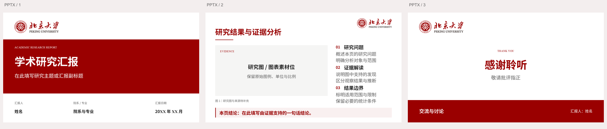

# Academic PPT Maker（学术汇报 PPT）

首版已实现“校徽取色 → 共用主题与内容 → 可编辑 PPTX + 离线 HTML”。首轮演示仅三页：首页、大图素材位与侧栏分析页、尾页。

## 从哪里开始

从 [SKILL.md](SKILL.md) 查看用法，或运行下方的本地生成命令。示例沿用北京大学校徽的实际配色，素材来源见 [校徽说明](assets/logos/SOURCES.md)。



中文默认 Noto Sans SC，英文默认 Times New Roman。样张没有真实实验结果，第二页是明确的素材占位。参考图里的虚线框、重复角标、灰色辅助线和页脚页码已省略。

## 日常修改只看这几个位置

| 想修改什么 | 去哪里 |
|---|---|
| 校徽、学校名称、取色覆盖 | `config/project.json`、`assets/logos/` |
| 题目、姓名、日期、要点、结论 | `content/demo.json` |
| 研究图与来源 | `figure.path`、`figure.caption`、`figure.alt` |
| 字体、内容文件、输出名称 | `config/project.json` |
| 字号、图像区大小、侧栏位置 | `config/layout.json` |
| 新增或大改版式 | `src/layouts.cjs` |
| 对话式生成入口 | `SKILL.md` |

项目目录：

```text
academic-ppt-maker/
  SKILL.md               skill 入口
  references/            取色、输入、版式与验收说明
  config/                项目设置与几何布局
  content/               可编辑内容 JSON
  assets/                官方示例校徽与允许分发的字体
  src/                   取色、版式、PPTX/HTML 与放映逻辑
  scripts/               构建与实际检查入口
  tests/                 取色和版本保留的回归检查
  output/                每次生成的独立版本
```

## 本地生成

安装 Node.js 20 或更新版本和 Python，然后在本项目根目录运行：

```powershell
npm install
python -m pip install -r requirements.txt
npm run build
```

本次生成的可编辑 PPTX、离线 HTML 和独立配色表都在 `output/` 下。每次构建生成新目录，最新目录记录在 `output/latest.json`。

如需实际检查两种格式，从同一目录运行：

```powershell
npm run check
npm run check:pptx
python -X utf8 scripts/check_pdf.py
node scripts/report.cjs
```

PPTX 的生成不依赖 Office。实际放映检查需要 Windows 上的 Microsoft PowerPoint，HTML 检查需要 Chrome、Edge 或 Playwright Chromium，可用 `CHROME_PATH` 指定浏览器。中文字体及许可随项目提供。离线 HTML 的英文优先使用本机 Times New Roman，缺失时回退为衬线字体。

## 换校徽与自动配色

1. 把新校徽放进 `assets/logos/`，推荐原始 SVG 或透明 PNG。
2. 编辑 `config/project.json`：更新 `school`、`logos.color` 和 `logos.source`，清空或更换旧的 `logos.reverse`。
3. 保持 `theme.primary` 与 `theme.officialPrimary` 为 null，再构建，就会自动按新校徽取色。

只查看取色结果：

```powershell
node scripts/palette.cjs
```

临时指定另一个校徽而不改配置：

```powershell
node scripts/build.cjs --logo 'D:\素材\校徽.png' --school '学校名称'
```

主色来自标识本身，过滤透明、白底、黑灰文字与杂点。多主色会给候选与推荐；黑白或质量不足时使用明确标注的中性灰草稿。配色文件记录实际取样色、最终使用色与选择依据，不冒充官方标准。

手动指定主色：设置 `theme.primary`，或在命令末尾加 `--primary '#005588'`。用户明确要求采用官方色时设置 `theme.officialPrimary`。手动色优先，其次官方色，再其次图像提取色。

首轮复用的官方北大校徽实际色为 `#9A0000`，生成深色 `#7B0000`、浅底 `#F9F0F0`。颜色集中在 `palette.json` 与共用模型里，不逐页改颜色。

## 修改内容和插入图片

编辑 `content/demo.json`。换行用 `\n`，保持 JSON 引号和逗号有效。将第二页 `figure.path` 从 null 改成图片路径即可替换素材位；路径相对于 `content/`，例如 `../assets/figures/result.png`。

图片完整适配到版面，不裁掉图例或坐标。同步填写 `caption` 中的图名与来源、`alt` 中的说明。数据与结论以你自己的材料为准。

当前三种版式是 `cover`、`evidence`、`closing`。evidence 最多三个侧栏要点，超出会提示拆页。过长内容不自动缩字；运行检查后根据实际效果改写或拆页。未来可以在 `src/layouts.cjs` 注册文献、流程、进度、多图对照等新布局。

## 用 skill 调用

在 Codex 中指定本项目的 `SKILL.md`，说明校徽、材料和用途，例如：

> 使用 本项目的 SKILL.md。根据我提供的校徽重新取色，把这份材料整理成三页样张，生成 PPTX 和离线 HTML，并执行本机可用的检查。

此入口由 agent 整理自然语言或文档材料；当前命令行生成器直接读取 JSON。尚未实现通用 Word/PDF 自动解析、复杂多图编辑器或所有参考版式。

## 三页样稿的验收

- 校徽取色与版本保留等 11 项回归检查通过，包含替换校徽后两种实际输出同步变色的检查。
- skill 格式检查通过，配套文件链接完整。
- HTML 实际离线打开、三页翻页、字体与图片、文字边界、多个视口、全屏失败回退通过。
- Microsoft PowerPoint 16.0 实际打开与渲染通过，三页无文字溢出，文字对象可编辑，保存包含嵌入字体文件。
- 两种 PDF 均为 3 页、960×540 pt，并保留模型中的全部可见文字。
- 全屏成功、所有目标电脑字体一致性和填入真实科研图片后的清晰度不属于本次已完成验收项。
